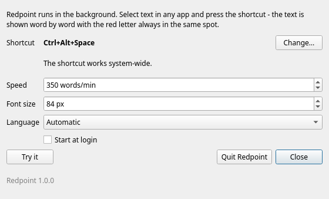

# Redpoint

**Select text anywhere, press one shortcut, read it word by word.**

Redpoint is a small background app for speed reading (RSVP). Words appear one at a time
in the same place on a black screen. One letter of each word, slightly left of the
middle (the *optimal recognition point*), is red and never moves, so your eyes do not
jump along the line.


- Works in any app: browser, PDF viewer, e-mail, chat, editor.
- One global shortcut, **Ctrl+Alt+Space** by default (Ctrl+Option+R on macOS), which you can change.
- Smart timing: longer words, numbers, commas, sentence and paragraph ends get more time,
  and the first words are a little slower so you can settle in.
- Keyboard and mouse control, a tray icon, start at login, English and Polish UI.
- Nothing leaves your computer: no network access, no accounts, no telemetry.

[Polski opis](README.pl.md)

## Download

Get the file for your system from the [latest release](https://github.com/DawidKrynski/redpoint-reader/releases/latest):

| System | File | How to start |
|---|---|---|
| Windows 10/11 (x64) | `Redpoint-…-windows-x64.exe` | Double-click. SmartScreen may warn about an unknown publisher: **More info → Run anyway**. |
| Linux (x86_64) | `Redpoint-…-x86_64.AppImage` | `chmod +x Redpoint-*.AppImage` and run it. No installation. |
| macOS (Apple silicon) | `Redpoint-…-macos-arm64.zip` | Unzip, move to Applications, right-click → **Open** the first time (the app is not notarized). |
| Any, with Python 3.10+ | `pipx install redpoint-reader` *(after the PyPI release)* or the wheel from the release | Run `redpoint`. |

On first start a short settings window explains the shortcut. After that Redpoint runs
in the background; open settings again from the tray icon or by starting the app again.

## Use

1. Select text.
2. Press the shortcut.
3. Read.

| Key | Action |
|---|---|
| Space, Enter, click | pause / resume (paused view shows time left) |
| ↑ / ↓, mouse wheel | speed ±25 words per minute (remembered) |
| ← / → | previous / next sentence |
| Shift+← / Shift+→ | previous / next word |
| Home | from the beginning |
| Esc, right click, the shortcut again | close |

Nothing selected? Redpoint reads the clipboard instead, so *copy + shortcut* always works.
From a terminal: `redpoint file.txt`, `some-command | redpoint -`, `redpoint --clipboard`.



## How it gets the selected text

| Platform | Shortcut | Selection |
|---|---|---|
| Windows | `RegisterHotKey` | simulated Ctrl+C, then your previous clipboard content is put back |
| Linux, KDE Plasma (X11 and Wayland) | KDE global shortcuts (shows up in System Settings → Shortcuts) | PRIMARY selection, no copying |
| Linux, other X11 desktops | `XGrabKey` | PRIMARY selection |
| Linux, other Wayland desktops | XDG GlobalShortcuts portal (GNOME 48+, Hyprland, …): the desktop asks you to confirm once | PRIMARY selection through the bundled `wl-paste` |
| Linux, Wayland without the portal (e.g. Sway) | bind a custom shortcut to `redpoint --read` in your compositor config; the settings window shows the exact command | PRIMARY selection |
| macOS | Carbon hot key | simulated Cmd+C (needs **Accessibility** permission), previous clipboard text restored |

## Settings file

`config.json` in `%APPDATA%\Redpoint` (Windows), `~/.config/redpoint` (Linux) or
`~/Library/Application Support/Redpoint` (macOS). Besides what the settings window offers
you can set `font_family`, `background`, `text_color`, `focus_color` and `start_paused`.

## Tested

- Windows 11 (VM): built executable, Notepad selection → shortcut → reading, clipboard restored.
- Linux: KDE Plasma 6 on Wayland (daily use); AppImage self-test under X11 with shortcut press and
  PRIMARY selection on Ubuntu 22.04 and 24.04, Debian 12, Fedora 42, Arch Linux, openSUSE Tumbleweed and Linux Mint 22.
- macOS: built and self-tested on GitHub's macOS runners (rendering, IPC, shortcut registration).
  Not yet tried by hand on a Mac: reports are welcome.

## Build from source

```bash
git clone https://github.com/DawidKrynski/redpoint-reader
cd redpoint-reader
uv sync --extra dev
uv run pytest
uv run redpoint
```

Packages: `packaging/build-appimage.sh` (inside `ubuntu:22.04`), `tools/build_windows.ps1`,
and the macOS steps in `.github/workflows/release.yml`. `redpoint --self-test DIR` renders the
reader and checks IPC, the shortcut backend and (with `REDPOINT_EXPECT_SELECTION`) the selection.

## License

GPL-3.0-or-later (Redpoint uses PyQt6, which is GPL). The Linux AppImage includes
[wl-clipboard](https://github.com/bugaevc/wl-clipboard) (GPL-3.0).
